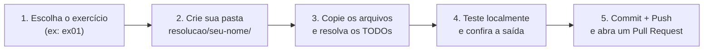

<div align="center">

# 🚀 Formação Dev — Repositório de Treinamento

**Trilhas práticas e progressivas para quem está começando do zero em programação.**


[📚 Projetos](#-projetos) • [🧩 Como Funciona](#-como-funciona-cada-exercício) • [🤝 Como Contribuir](#-como-enviar-sua-resolução) • [🛠️ Comandos Git](#️-comandos-úteis-de-git)

</div>

---

## 📚 Projetos

| Projeto | Tecnologia | Exercícios | Foco |
| :--- | :--- | :---: | :--- |
| ☕ [`formacaoJava/`](./formacaoJava/README.md) | Java 25 (Maven) | **50** (`ex01`–`ex50`) | Lógica, tipos primitivos, listas, métodos e POO (`Pessoa`, `Carro`). |
| 🟨 [`formacaoJs/`](./formacaoJs/README.md) | JavaScript (Node.js) | **50** (`ex01`–`ex50`) | Lógica, funções, arrays, objetos e manipulação de dados no console. |
| 🎨 [`formacaoHtmlCss/`](./formacaoHtmlCss/README.md) | HTML5 & CSS3 | **15** (`ex01`–`ex15`) | Semântica, Box Model, Flexbox, CSS Grid e responsividade. |
| 🌐 [`formacaoWeb/`](./formacaoWeb/README.md) | HTML + CSS + JS | **25** (`ex01`–`ex25`) | DOM, eventos, formulários, `localStorage`, `fetch` API e mini-apps. |

---

## 🧩 Como funciona cada exercício

Dentro da pasta de exercícios de qualquer projeto (`ex01`, `ex02`, etc.), você sempre encontrará:

1. **`README.md`** — O objetivo, o passo a passo e o **resultado esperado**.
2. **Arquivos base** — O ponto de partida do exercício.
3. **`resolucao/`** — Pasta onde cada participante envia a sua própria solução.

> [!IMPORTANT]
> **Não altere os arquivos base do exercício!** Sempre copie os arquivos para dentro de `resolucao/<seu-nome>/` antes de começar a codar.

---

## 🤝 Como enviar sua resolução



> [!TIP]
> Use um nome padrão para sua pasta (ex: `joao-silva` ou seu usuário do GitHub) em todos os exercícios para facilitar o acompanhamento da sua evolução!

---

## 🛠️ Comandos úteis de Git

<details>
<summary>Clique para ver o passo a passo de como enviar sua resolução</summary>

```bash
# 1. Atualize seu repositório local
git pull origin main

# 2. Adicione apenas a sua pasta de resolução
git add formacaoJava/src/main/java/formacao/exercicios/ex01/resolucao/seu-nome/

# 3. Faça o commit
git commit -m "feat(java): resolucao ex01 - seu-nome"

# 4. Envie para o GitHub
git push
```

</details>
